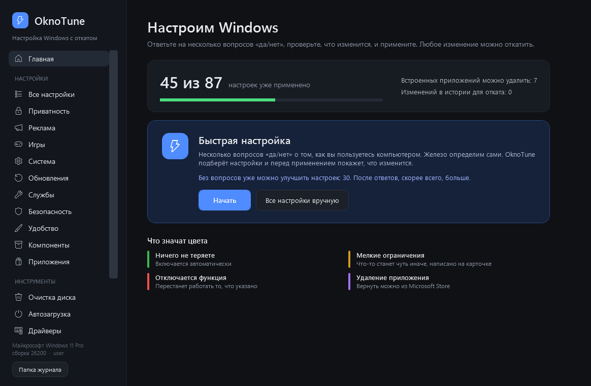
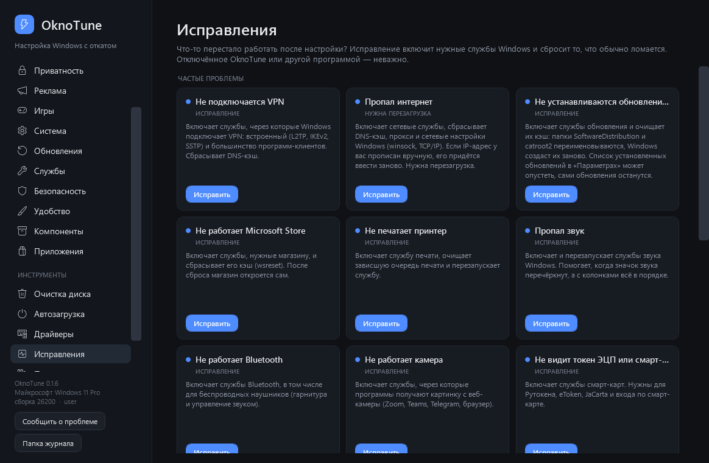
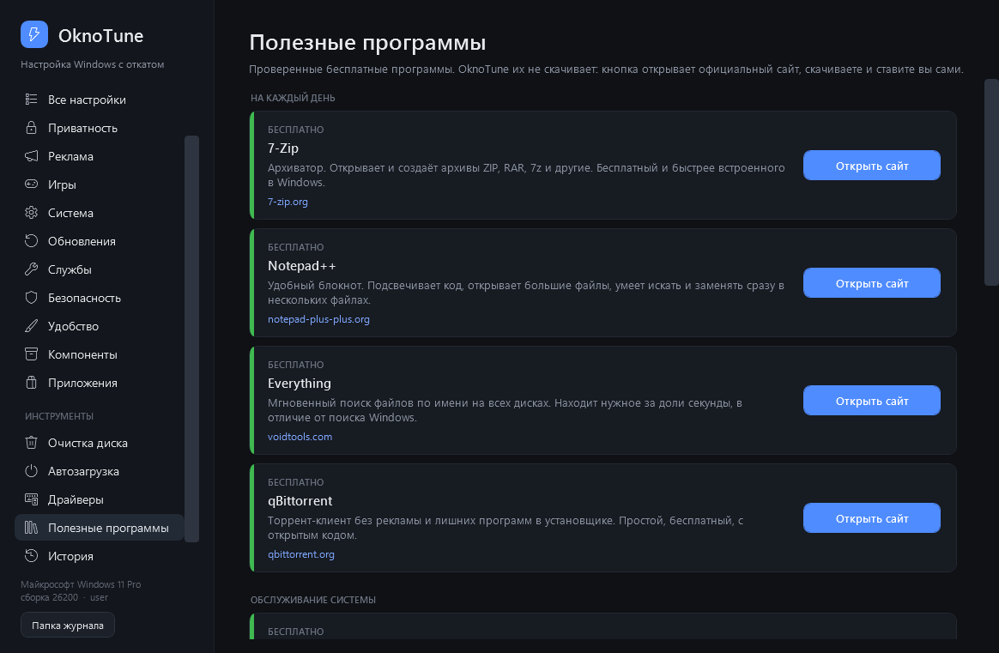
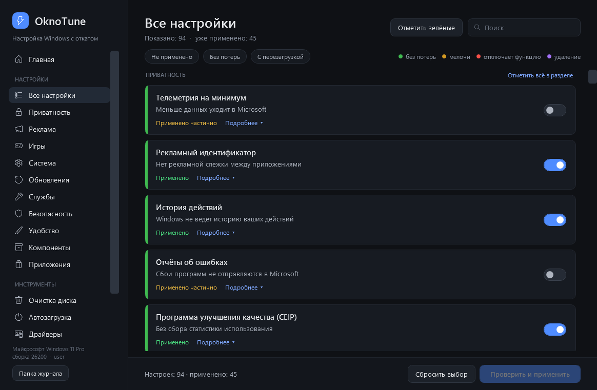

<div align="center">


# OknoTune

**Настройка Windows 10/11 с откатом: просто, понятно и без риска**

[](#-быстрый-запуск)
[](https://github.com/equ1pt/OknoTune/releases/latest)
[](LICENSE)




</div>

---

## 🚀 Быстрый запуск

Два способа, выбирайте любой. Windows попросит права администратора: нажмите «Да». OknoTune откроется в своём окне.

### 1. Файл OknoTune.exe

Скачайте **[OknoTune.exe](https://github.com/equ1pt/OknoTune/releases/latest/download/OknoTune.exe)** и запустите его. Файл можно переслать кому угодно.

- При запуске он сам проверяет, нет ли на GitHub версии новее, и если есть, запускает её.
- Нет интернета или GitHub недоступен — запустится версия, которая лежит внутри файла.
- Если появится SmartScreen: «Подробнее» → «Выполнить в любом случае». Файл не подписан, поэтому Windows его не знает.

### 2. Команда в PowerShell

Откройте **PowerShell** (`Win + X` → «Терминал») и вставьте:

```powershell
irm https://raw.githubusercontent.com/equ1pt/OknoTune/main/run.ps1 | iex
```

Каждый раз скачивается последняя версия. Нужен интернет.

<details>
<summary>📦 Ещё способ: скрипт из архива</summary>

1. Скачайте архив: **Code → Download ZIP** и распакуйте его.
2. Дважды щёлкните `OknoTune.cmd` и согласитесь на права администратора.
3. Если появится SmartScreen: «Подробнее» → «Выполнить в любом случае».

</details>

---

## ✨ Возможности

| | |
|---|---|
| 🧙 **Быстрая настройка** | Несколько вопросов «да/нет». Ноутбук или ПК, SSD или HDD OknoTune определит сам |
| 🎛️ **Около 90 настроек** | Приватность, реклама, игры, службы, обновления, удобство, встроенные приложения |
| 🔍 **«Что изменится»** | Перед применением видно каждое изменение и предупреждения |
| ↩️ **Откат** | Любое применение можно отменить в разделе «История» |
| 💾 **Профили** | Сохраните выбранные настройки в файл и примените их на другом ПК |
| 🩹 **Исправления** | Не работает VPN, интернет, звук, принтер, камера, обновления? Одна кнопка вернёт нужные службы |
| 🔧 **Ремонт Windows** | Восстановление системных файлов (DISM и sfc) и проверка диска |
| 🌐 **DNS** | Cloudflare, Google или AdGuard в один клик, прежний DNS можно вернуть |
| 🧹 **Очистка диска** | Временные файлы, кэши обновлений, браузеров, шейдеров. Размер виден до удаления |
| 🚦 **Автозагрузка** | Отключение обратимо: запись возвращается одним нажатием |
| 🖥️ **Драйверы** | Возраст драйверов и ссылка на сайт производителя |
| 🧰 **Полезные программы** | Проверенные бесплатные программы: установка через winget или ссылка на сайт |
| 🪟 **Классические окна** | Панель управления, сетевые подключения, электропитание, службы — в одном месте |

### 🎨 Цвета на карточках

- 🟢 **Ничего не теряете**: безопасно, включается автоматически
- 🟡 **Мелкие ограничения**: что-то станет чуть иначе, это написано на карточке
- 🔴 **Отключается функция**: перестанет работать то, что указано
- 🟣 **Удаление приложения**: вернуть можно из Microsoft Store

---

## 🩹 Исправления



Частые случаи, когда после «оптимизации» что-то перестаёт работать: VPN, интернет, обновления Windows, Microsoft Store, принтер, звук, Bluetooth, камера, токен ЭЦП, поиск в Пуске, время на часах.

Исправление включает только **отключённые** службы, нужные для этой функции, и делает стандартный сброс (DNS-кэш, очередь печати, кэш обновлений). Прежние настройки служб сохраняются в «Историю».

---

## 🧰 Полезные программы



«Установить» ставит программу через **winget**, менеджер программ Windows, в отдельном окне. winget скачивает обычный установщик с сайта разработчика, версии из Microsoft Store не используются. Условия лицензии winget покажет там же, принимаете их вы сами. Если пакета в winget нет, кнопка открывает официальный сайт.

OknoTune не распространяет эти программы: он даёт ссылку или передаёт установку winget. У каждой программы своя лицензия. Например, Dr.Web CureIt! бесплатен только для домашнего использования.

| Категория | Программы |
|---|---|
| 🌐 Интернет | Google Chrome, qBittorrent |
| 🎮 Игры и общение | Steam, Discord, Telegram |
| 📁 Файлы | 7-Zip, Notepad++, Everything, SpaceSniffer |
| 🛠️ Обслуживание системы | HiBit Uninstaller, Easy Service Optimizer, DriverStore Explorer, Device Cleanup Tool |
| 🛡️ Проверка на вирусы | Kaspersky Virus Removal Tool, Dr.Web CureIt!, AdwCleaner |

---

## 🛡️ Безопасность

- 🔒 **Ничего не отправляет.** Нет телеметрии и скрытых загрузок: из интернета скачиваются только программы, для которых вы сами нажали «Установить». Весь код в одном файле `OknoTune.ps1`, его можно прочитать.
- 💾 **Снимок перед каждым изменением.** Снимки и журнал лежат в `%LOCALAPPDATA%\OknoTune`.
- 🧷 **Точка восстановления.** Её можно создать в окне подтверждения.
- 🙅 **Защиту Windows не трогает.** Defender, UAC, SmartScreen и брандмауэр остаются как есть.

> [!WARNING]
> OknoTune меняет настройки системы. Используйте на свой риск и включайте точку восстановления.
> Удалённые встроенные приложения откатом не вернуть: их ставят заново из Microsoft Store.
> Удалённые при очистке файлы не восстанавливаются.



---

## ❓ Вопросы

<details>
<summary><b>Антивирус ругается на скрипт</b></summary>

Скрипт меняет реестр и службы, поэтому некоторые антивирусы относятся к нему с подозрением. Код открыт, его можно проверить перед запуском.
</details>

<details>
<summary><b>Как вернуть всё назад?</b></summary>

Каждое нажатие «Применить» сохраняет снимок прежних значений. В разделе «История» нажмите «Откатить» у нужного применения: вернётся всё, что изменило именно оно.

Отдельную настройку можно выключить переключателем в списке: она вернётся к значению Windows по умолчанию.

Если что-то пошло совсем не так, используйте точку восстановления Windows.
</details>

<details>
<summary><b>Нужен ли интернет?</b></summary>

Для запуска через `irm`, установки программ через winget, ремонта системных файлов и синхронизации времени. Настройки, откат, очистка и остальные исправления работают без интернета.
</details>

---

## 💬 Нашли проблему или есть идея?

Нажмите **«Сообщить о проблеме»** внизу меню программы. Откроется [Google Форма](https://forms.gle/osFKG9XiCYuB4s4f7), где уже заполнены версия OknoTune, Windows и конец журнала (имя пользователя и компьютера заменены). Входить в Google не нужно, отправляете вы сами. Форма не собирает контакты: пожалуйста, не пишите в ней имя, телефон, почту и другие личные данные. Исправления по заявкам появляются в описаниях релизов.

Можно и без программы: [открыть форму](https://forms.gle/osFKG9XiCYuB4s4f7).

---

## 👩‍💻 Для разработчиков

`OknoTune.ps1` собирается из файлов в `parts/` по порядку имён:

```powershell
powershell -ExecutionPolicy Bypass -File build.ps1
```

Рядом собирается `OknoTune.exe` (исходник в `launcher/`): в нём лежит текущий `OknoTune.ps1`. При запуске он берёт свежую версию из последнего релиза на GitHub, а без интернета запускает свою. Приложите `.exe` к релизу.

Проверки без изменений в системе:

```powershell
.\OknoTune.ps1 -Selftest                         # состояние, без окна
.\OknoTune.ps1 -Snapshot a.png -View apps        # отрисовать экран в PNG
# -View: home | wizard | review | list | history | clean | startup | drivers | apps
```

---

<div align="center">

📄 Лицензия [MIT](LICENSE) · ⭐ Если пригодилось, поставьте звезду

</div>
